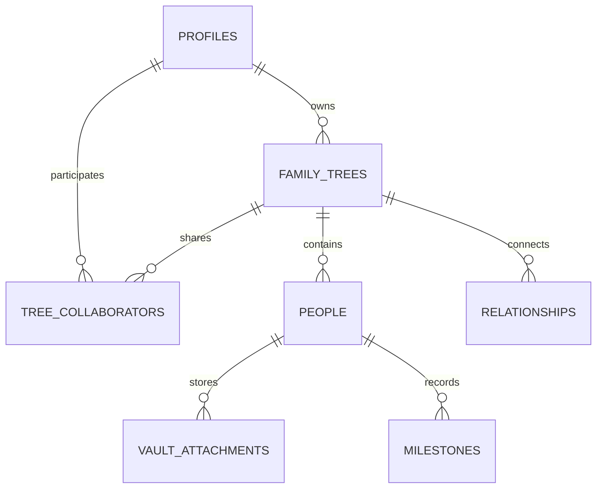

# Project Natal: Product & Technical Specification (SPEC)
**Version:** 1.0.0  
**Status:** Approved Architecture Draft  
**Target Architecture:** Production-Grade Modern Genealogy & Oral History Platform  
**Repository:** [github.com/dharmincdev/project-natal](https://github.com/dharmincdev/project-natal)  

---

## 1. Executive Summary & Product Vision

### 1.1 The Problem
Legacy genealogy platforms (Ancestry, FamilySearch, MyHeritage) suffer from several structural drawbacks:
1. **Outdated, Static Visualizations:** Cluttered, rigid chart views that feel like 1990s desktop software.
2. **Missing Oral History & Emotion:** They store dry census dates and documents, ignoring the authentic voices, audio stories, and memories of living elders.
3. **Walled Gardens & Inflexible Sharing:** Complex registration friction for casual family members, high monthly subscriptions (\$30–\$50/mo), and poor mobile responsiveness.
4. **Lack of Modern Intelligence:** Little to no conversational reasoning over family records.

### 1.2 The Solution: Project Natal
Project Natal is an interactive, modern, and privacy-first family history platform designed for the next generation of genealogists and family archivists:
* **High-Performance 2D Canvas:** Smooth, interactive generational graph built on `@xyflow/react` with orthogonal descent lineages and automatic generational clustering.
* **Multi-Dimensional Viewports:** 3D Orbital Constellations (`🪐 3D`), Chronological Lifespan Timelines (`⏳ Timeline`), and an interactive 3D World Migration Globe (`🌍 Globe`).
* **Oral History & Document Vault:** In-browser audio recording with live frequency soundwave visualization, drag-and-drop document archiving, and automated speech-to-text transcription.
* **AI Family Historian:** Grounded natural-language reasoning agent that answers complex kinship queries, timeline queries, and searches oral transcripts without hallucinating.
* **Frictionless Collaboration & Sharing:** Role-based multi-user collaboration (Owner, Editor, Viewer), dynamic QR codes for mobile exploration, and public read-only links with living-person privacy protection.
* **Data Sovereignty & Interoperability:** Complete bi-directional GEDCOM 7.0 import/export and high-res vector (SVG/PDF/PNG) exports.
* **Accessible Pricing:** Free tier (up to 25 members), \$5 one-time lifetime pass (up to 100 members), and a \$7/month Pro tier for unlimited members, AI historian, and audio vault capabilities.

---

## 2. System Architecture & Technology Stack

```
┌─────────────────────────────────────────────────────────────────────────────┐
│                           Client (Browser / PWA)                            │
│  Next.js 16 (React 19) • Tailwind CSS v4 • shadcn/ui • @xyflow/react • Three.js │
└───────────────────────┬─────────────────────────────────┬───────────────────┘
                        │ HTTPS / WebSocket               │ Signed URL Uploads
                        ▼                                 ▼
┌───────────────────────────────────────┐   ┌─────────────────────────────────┐
│     Next.js Server & Route Handlers   │   │        Supabase Storage         │
│  (Auth, Zod Validation, Stripe APIs)  │   │  (Audio Stories, Photos, PDFs)  │
└───────────────────────┬───────────────┘   └─────────────────────────────────┘
                        │
                        ▼
┌─────────────────────────────────────────────────────────────────────────────┐
│                          Supabase Cloud Platform                            │
│  PostgreSQL Database (Row-Level Security, Constraints, Full-Text Search)    │
│  Realtime WebSockets (Live Presence, Collaborative Broadcast Changes)       │
│  GoTrue Auth (Email OTP Magic Links, Google OAuth)                          │
└───────────────────────┬─────────────────────────────────┬───────────────────┘
                        │                                 │
                        ▼                                 ▼
         ┌─────────────────────────────┐   ┌────────────────────────────────┐
         │       Stripe Payments       │   │           OpenAI API           │
         │  Checkout Sessions & Webhook│   │  GPT-4o-mini & Whisper Audio   │
         └─────────────────────────────┘   └────────────────────────────────┘
                        │ (Optional Future Extension)
                        ▼
         ┌──────────────────────────────────────────────────────────────────┐
         │              Asynchronous Python ML Worker (FastAPI)             │
         │  Local Whisper Transcription • Historical Census OCR • Record    │
         │  Entity Resolution & Linkage                                     │
         └──────────────────────────────────────────────────────────────────┘
```

### 2.1 Core Stack
* **Language:** Unified TypeScript across frontend, backend, and database schema types.
* **Frontend Framework:** Next.js 16.3+ (App Router) with React 19.
* **Styling & Components:** Tailwind CSS v4, `@base-ui/react`, Radix primitives, Lucide icons.
* **Graph & Diagramming Engine:** `@xyflow/react` v12.11+ (React Flow) with custom layout relaxation math.
* **3D Visualizations:** `three` (v0.185+) and `@types/three` for 3D Orbit and World Globe.
* **Database & Auth:** Supabase PostgreSQL with strict Row-Level Security (RLS) policies and Supabase Auth (OTP & OAuth).
* **Payments & Billing:** Stripe Node SDK (`stripe` v22+) & `@stripe/stripe-js`.
* **Audio & Media:** HTML5 Web Audio API + MediaRecorder, with fallback simulated audio for headless/automated environments.
* **Speech-to-Text & AI:** OpenAI API (`gpt-4o-mini` for chat and `whisper-1` for audio memory transcription), paired with an offline heuristic fallback reasoner.

### 2.2 Backend Language Strategy (TypeScript vs. Python)
* **Unified TypeScript Core:** The entire transactional application (CRUD, auth, permissions, Stripe billing, graph queries, server actions) runs on TypeScript in Next.js + Supabase. This guarantees 100% end-to-end type safety without serialization overhead between microservices.
* **Optional Asynchronous Python Worker (Decoupled Microservice):** If future requirements introduce heavy local machine learning (e.g., self-hosted Whisper transcription, complex census OCR scanning, or deep graph embeddings), these will run as an isolated Python worker consuming background tasks from a message queue, leaving the primary Next.js backend decoupled and lightweight.

---

## 3. Domain Model & Database Schema

### 3.1 Entity Relationship Diagram



### 3.2 Schema Definitions

#### 1. `profiles`
* `id` (UUID, PK, references `auth.users`)
* `email` (TEXT, unique, not null)
* `name` (TEXT)
* `avatar_url` (TEXT)
* `tier` (TEXT, enum: `'free' | 'onetime' | 'pro'`, default: `'free'`)
* `stripe_customer_id` (TEXT)
* `stripe_subscription_id` (TEXT)
* `created_at` / `updated_at` (TIMESTAMPTZ)

#### 2. `family_trees`
* `id` (UUID, PK)
* `owner_id` (UUID, references `profiles.id`, not null)
* `name` (TEXT, not null)
* `slug` (TEXT, unique, not null)
* `description` (TEXT)
* `settings` (JSONB, containing `{ isPublic: boolean, allowClaiming: boolean, theme: string, livingPrivacyRedaction: boolean }`)
* `created_at` / `updated_at` (TIMESTAMPTZ)

#### 3. `people`
* `id` (UUID, PK)
* `tree_id` (UUID, references `family_trees.id` ON DELETE CASCADE, not null)
* `first_name` (TEXT, not null)
* `last_name` (TEXT)
* `maiden_name` (TEXT)
* `nickname` (TEXT)
* `gender` (TEXT, enum: `'male' | 'female' | 'other' | 'unknown'`)
* `birth_date` (DATE)
* `death_date` (DATE)
* `birth_place` (TEXT)
* `death_place` (TEXT)
* `photo_url` (TEXT)
* `bio` (TEXT)
* `custom_fields` (JSONB, key-value attributes like occupation, education, religion)
* `position_x` / `position_y` (FLOAT, stored canvas coordinates)
* `created_at` / `updated_at` (TIMESTAMPTZ)

#### 4. `relationships`
* `id` (UUID, PK)
* `tree_id` (UUID, references `family_trees.id` ON DELETE CASCADE, not null)
* `person_a_id` (UUID, references `people.id` ON DELETE CASCADE, not null)
* `person_b_id` (UUID, references `people.id` ON DELETE CASCADE, not null)
* `type` (TEXT, enum: `'parent_child' | 'spouse' | 'sibling'`, not null)
* `subtype` (TEXT, enum: `'biological' | 'step' | 'adoptive' | 'half'`, default: `'biological'`)
* `start_date` / `end_date` (DATE)
* `created_at` (TIMESTAMPTZ)
* **Constraints:**
  - `CHECK (person_a_id != person_b_id)`
  - Unique index on `(tree_id, LEAST(person_a_id, person_b_id), GREATEST(person_a_id, person_b_id), type)` to prevent duplicate symmetric links.

#### 5. `vault_attachments`
* `id` (UUID, PK)
* `person_id` (UUID, references `people.id` ON DELETE CASCADE, not null)
* `tree_id` (UUID, references `family_trees.id` ON DELETE CASCADE, not null)
* `title` (TEXT, not null)
* `type` (TEXT, enum: `'audio' | 'document' | 'photo'`, not null)
* `url` (TEXT, not null) — Supabase Storage URL or local URI
* `file_size` (BIGINT)
* `duration` (FLOAT) — Duration in seconds for audio files
* `recorded_at` (TIMESTAMPTZ)
* `transcript` (TEXT) — Full speech-to-text transcript
* `created_at` (TIMESTAMPTZ)

#### 6. `tree_collaborators`
* `id` (UUID, PK)
* `tree_id` (UUID, references `family_trees.id` ON DELETE CASCADE, not null)
* `email` (TEXT, not null)
* `user_id` (UUID, references `profiles.id` ON DELETE SET NULL)
* `role` (TEXT, enum: `'owner' | 'editor' | 'viewer'`, not null)
* `status` (TEXT, enum: `'pending' | 'accepted'`, not null)
* `invited_by` (UUID, references `profiles.id`)
* `created_at` / `updated_at` (TIMESTAMPTZ)

---

## 4. Graph Architecture & Layout Invariants

### 4.1 Directed Acyclic Graph (DAG) Integrity & Cycle Detection
Family lineages must satisfy a strict **Directed Acyclic Graph (DAG)** constraint for parent-child relations:
* **The "I'm My Own Grandpa" Paradox Prevention:** An individual cannot be their own ancestor. Before inserting any `parent_child` edge where `Person A` is parent of `Person B`:
  1. A graph traversal checks whether `Person A` is reachable as a descendant of `Person B`.
  2. If a cycle is detected, the transaction is rejected with an explicit error code (`CYCLE_DETECTED: Person cannot be ancestor of themselves`).

### 4.2 Generational Auto-Layout Algorithm
The layout engine (`src/lib/layout.ts`) positions nodes deterministically:
1. **Generational Depth Calculation:**
   - Roots (ancestors with no parents) start at `Generation 0`.
   - `gen[Child] = max(gen[Parent_1], gen[Parent_2]) + 1`.
   - Spouses and partners are synchronized to the identical generational level: `gen[A] = gen[B] = max(gen[A], gen[B])`.
   - A relaxation loop runs up to 15 iterations until all generational depths stabilize.
2. **Family Unit Clustering:**
   - In each generation, individuals are clustered into "Family Units" (married couples or single parent groups).
   - Horizontal spacing constants:
     - Card width: `256px`
     - Spouse horizontal gap: `50px`
     - Inter-family unit gap: `100px`
     - Generational row height: `220px`
3. **Orthogonal Lineage Routing:**
   - Parent-child descent lines utilize orthogonal channel routing: lines emerge from the midpoint between parents, drop vertically into a generational transit rail, and branch down to children to eliminate crossed lines.

### 4.3 Dynamic Kinship Computing Engine
The kinship module computes exact genealogical consanguinity and affinity between any arbitrary pair of nodes (`Person A` and `Person B`):
* **Lowest Common Ancestor (LCA) Search:** Traverses upwards to identify shared ancestors.
* **Degree Calculation:**
  - $0$ generational difference + direct parents = Sibling.
  - $0$ generational difference + shared grandparents = First Cousin.
  - Generational offset $k$: "Removed" degree ($k$ times removed).
  - Half-sibling detection via single shared parent.
  - Step-relationships detected via non-biological marital edges.

---

## 5. Feature Modules Specification

### 5.1 2D Interactive Canvas Engine
* Built with `@xyflow/react` v12.
* **Features:**
  * Node dragging with automatic coordinate debounced auto-saving.
  * Direct handle dragging: connecting a handle from one card to another pops open the connection confirmation dialog.
  * **Auto-Align:** Single-click realignment that reorganizes cards into clean generational tiers while preserving manual positioning if desired.
  * Visual status badges for living/deceased, maiden names `(née ...)`, and gender indicators (`♂`, `♀`).

### 5.2 Multi-Dimensional Visualizations
* **3D Orbital Constellation (`src/components/tree/TreeOrbit3D.tsx`):**
  * Three.js canvas utilizing spherical Fibonacci node distributions grouped by generation.
  * Glowing connective spline arcs between parents, spouses, and children.
  * Mouse orbit, zoom, and node selection with auto-camera fly-to.
* **Chronological Timeline Stream (`src/components/tree/TreeTimeline.tsx`):**
  * Time-traveler year scrubber from earliest ancestor birth year to present.
  * Lifespan track bars visualizing overlapping generations, longevity, and key life milestones.
* **3D World Migration Globe (`src/components/tree/TreeWorldGlobe.tsx`):**
  * Interactive Three.js globe mapping ancestral birthplaces to latitude/longitude coordinates via the geocoding library (`src/lib/geo.ts`).
  * Migration trajectory arcs connecting birthplace to deathplace or parental origin.
  * Toggle between 3D spherical projection and 2D flat Equirectangular projection.

### 5.3 Oral History & Document Vault
* **Recording Studio (`src/components/tree/AudioRecorder.tsx`):**
  * In-browser high-fidelity voice recording using `MediaRecorder` (`audio/webm` or `audio/mp4`).
  * Live Web Audio `AnalyserNode` rendering an animated multi-frequency soundwave.
  * In-memory playback, scrubbing, duration calculation, and simulated fallback for headless/server environments.
* **Automated Speech-to-Text (Whisper):**
  * Upon saving an oral story, the audio payload is submitted to OpenAI `whisper-1` (or local worker).
  * The transcribed text is attached to the record and indexed in PostgreSQL for full-text keyword search.
* **Historical Document Vault:**
  * Supports drag-and-drop archiving of birth certificates, census scans, immigration papers, and photos up to 25MB per file.

### 5.4 AI Family Historian (`src/lib/ai/chat.ts`)
* Built on OpenAI `gpt-4o-mini`.
* **Grounding Protocol:**
  * Uses a strict system prompt instructing the AI to answer *only* from the serialized family tree graph and oral history transcripts.
  * If an answer is absent from the data, it politely indicates that the detail has not yet been added to the family tree, completely preventing hallucinations.
* **Offline Fallback Engine:**
  * If no `OPENAI_API_KEY` is configured or the network is unreachable, an intelligent local heuristic parser answers questions on birthdays, oldest/youngest members, relative counts, and kinship relations.

### 5.5 Interoperability & Data Portability
* **GEDCOM 7.0 Parser & Exporter (`src/lib/gedcom/`):**
  * Adheres strictly to the FamilySearch GEDCOM 7.0 specification.
  * Supports `INDI` (Individual), `FAM` (Family), `HUSB`, `WIFE`, `CHIL`, `BIRT`, `DEAT`, `PLAC`, and custom extensions.
* **Visual Vector Export:**
  * High-resolution canvas PNG rendering.
  * Scalable Vector Graphics (SVG) export for lossless printing.
  * Multi-page printable PDF family poster generation.

---

## 6. Privacy, Security & Collaboration

### 6.1 Living Person Privacy Redaction (Genealogy Standard)
To comply with global privacy standards (GDPR, CCPA) and protect living relatives:
* An individual is deemed **Living** if `death_date` is null and estimated age is $< 100$ years.
* When a tree is viewed via a public read-only link (`/t/[slug]`) by an unauthenticated visitor:
  * Deceased ancestors are rendered with full names, dates, biographies, and historical documents.
  * Living individuals are automatically redacted: displayed as *"Living Relative"*, with birth dates, sensitive custom fields, and photos hidden.
* Authenticated collaborators with `Viewer` or `Editor` roles can view full details according to their permissions.

### 6.2 Role-Based Access Control (RBAC) Matrix

| Capability | Public Visitor | Viewer | Editor | Owner |
| :--- | :---: | :---: | :---: | :---: |
| View Tree Canvas | ✓ (Redacted) | ✓ (Full) | ✓ (Full) | ✓ (Full) |
| Search Spotlight (⌘K) | ✓ | ✓ | ✓ | ✓ |
| Play Public Audio Stories | ✓ | ✓ | ✓ | ✓ |
| Add / Edit / Move Relatives | ✗ | ✗ | ✓ | ✓ |
| Record Audio Memories | ✗ | ✗ | ✓ | ✓ |
| Import / Export GEDCOM | ✗ | ✓ | ✓ | ✓ |
| Manage Collaborators | ✗ | ✗ | ✗ | ✓ |
| Delete Tree | ✗ | ✗ | ✗ | ✓ |

### 6.3 Row-Level Security (RLS) Policies
PostgreSQL RLS is enabled on all tables:
* `family_trees`: Readable if `settings->>'isPublic' = 'true'` OR user is owner OR user has an accepted record in `tree_collaborators`.
* `people`, `relationships`, `vault_attachments`: Inherit access via parent `tree_id`.
* Mutations (`INSERT`, `UPDATE`, `DELETE`) require `owner` or `editor` role checked via security definer function `has_tree_permission(tree_id, 'editor')`.

---

## 7. Monetization & Subscription Entitlements

| Feature | Free Tier | One-Time Pass (\$5) | Pro Tier (\$7 / mo) |
| :--- | :---: | :---: | :---: |
| **Max Relatives** | 25 People | 100 People | **Unlimited** |
| **Canvas Modes** | 2D Flat Canvas | 2D + 3D Orbit + Timeline | **All (Flat, 3D, Timeline, Globe)** |
| **QR Code Sharing** | ✗ | ✓ | ✓ |
| **GEDCOM 7.0 Export** | ✓ | ✓ | ✓ |
| **Printable PDF Posters**| ✗ | ✓ | ✓ |
| **Oral History Vault** | 3 Audio Stories | 10 Audio Stories | **Unlimited Audio & Documents** |
| **AI Family Historian** | ✗ | ✗ | **✓ Unlimited AI Chat & Search** |
| **Live Collaboration** | Up to 2 Members | Up to 5 Members | **Unlimited Real-Time Collaborators** |

* Billing is handled via Stripe Checkout Sessions and verified through Stripe Webhooks (`checkout.session.completed`, `customer.subscription.deleted`).

---

## 8. Quality Assurance & Engineering Standards

### 8.1 Verification Pyramid
* **Unit Tests (Vitest):**
  * Generational layout relaxation math (`src/lib/__tests__/layout.test.ts`).
  * Directed Acyclic Graph (DAG) cycle detection & LCA kinship calculations (`src/lib/__tests__/graph-invariants.test.ts`).
  * Living individual privacy redaction engine (`src/lib/__tests__/privacy.test.ts`).
  * Role-Based Access Control (RBAC) capability matrix (`src/lib/__tests__/permissions.test.ts`).
  * Zod contract validation schemas for PostgreSQL types (`src/lib/__tests__/contracts.test.ts`).
  * Stripe webhook lifecycle events & tier upgrades/downgrades (`src/lib/__tests__/stripe-webhook.test.ts`).
  * Tree vector SVG/PNG export engine (`src/lib/__tests__/tree-export.test.ts`).
* **End-to-End Tests (Playwright):**
  * Core demo tree canvas, views & oral history audio vault (`e2e/demo.spec.ts`).
  * Homepage hero, navigation, and Bento showcase (`e2e/home.spec.ts`).
  * GEDCOM 7.0 interoperability & modal workflows (`e2e/gedcom.spec.ts`).
  * Public tree living person privacy redaction (`e2e/privacy.spec.ts`).
  * Adversarial graph cycle prevention & duplicate relationship validation (`e2e/graph-integrity.spec.ts`).
* **Manual Interactive Checklist (`/qa`):**
  * 50 test cases across 10 functional suites persisted in browser storage.
  * Direct launch buttons for rapid feature verification.

### 8.2 CI/CD Automation (GitHub Actions)
Every pull request to `main` must pass:
1. `npx tsc --noEmit` (TypeScript strict mode, 0 errors).
2. `npm run lint` (ESLint Next.js configuration, 0 errors).
3. `npm run test:unit` (Vitest unit test suite).
4. `npx playwright test` (E2E browser test suite).
5. `npm run build` (Next.js production compilation & static page optimization).
